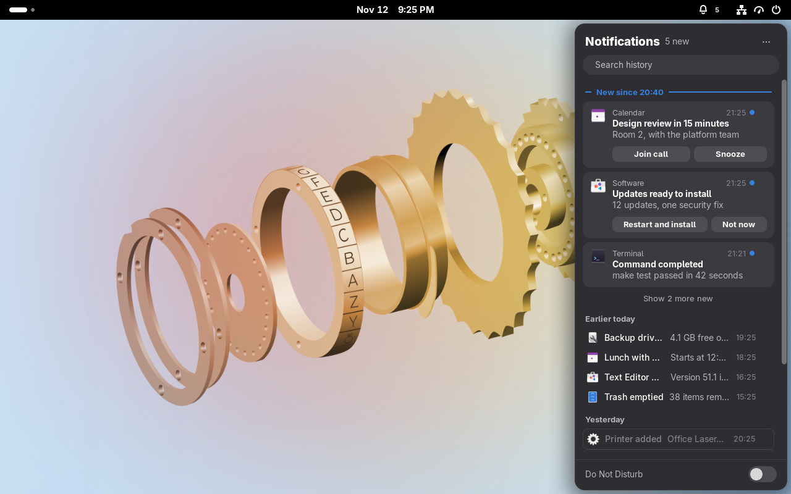
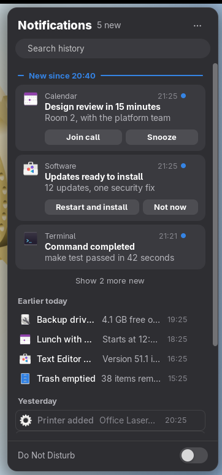
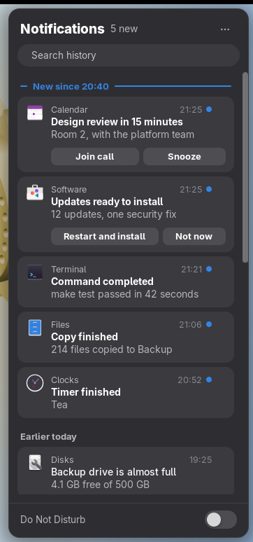
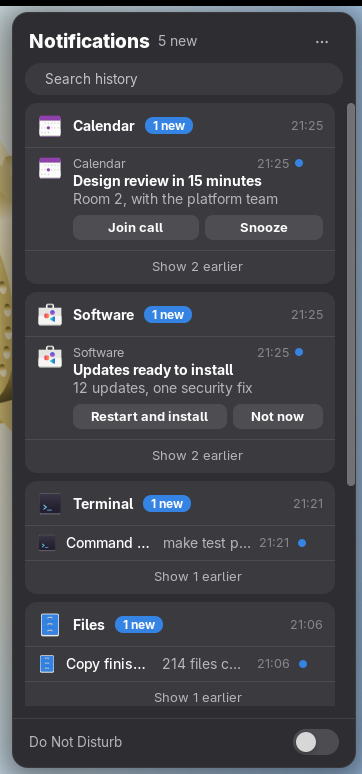

# Notification sidebar

**Step away from your desk. Come back to everything you missed, in one place.**

GNOME shows a notification for a few seconds, keeps ten per app in the clock menu, and forgets all of them when you log out. Notification sidebar remembers. It records every notification, keeps it for days across logout and reboot, and puts the whole history in a panel on the right edge of the screen. Press Super+V and the first thing you see is what arrived since you last looked.



It is a GNOME Shell extension for GNOME Shell 51 on Wayland. Your history stays in a file on your own machine; nothing is sent anywhere.

## Three ways to read it

The same history, laid out the way you think. Switch from the panel's menu at any time.

| New, then history | Timeline | By app |
|---|---|---|
|  |  |  |
| What is new gets room; what you have seen shrinks to a line. | One stream, newest first, with nothing folded away. | One block per app, so a noisy app stays in its own box. |

## What it does

- Records each notification as it arrives. Transient notifications are skipped.
- Opens a panel from a bell button in the top bar, or with Super+V. Esc, a click outside, the bell or Super+V closes it.
- Shows what arrived since the panel was last open. The bell shows the count.
- Offers three views of the same history: Timeline, By app, and New, then history. Choose one from the panel's menu (the three dots) or in settings.
- Searches the history by app name, title and body.
- Shows the action buttons of notifications that are still live. Entries from a previous session can open their app but have no buttons.
- Shows media player controls when a player is running, because removing GNOME's list from the clock menu removes the controls that were inside it.
- Has a Do Not Disturb switch at the bottom, tied to GNOME's own setting.
- Replaces the notification list in the clock menu, and takes over the shortcut that opened it. The calendar, events, weather and world clocks stay.

## Install

You need GNOME Shell 51. From a checkout of this repository:

```
make install
```

Log out and back in. Wayland cannot load a new extension into a running session. Then:

```
gnome-extensions enable notification-sidebar@bradvrudney.github.io
```

To turn it off, use Extension Manager, or run this in a terminal or a text console (Ctrl+Alt+F3):

```
gnome-extensions disable notification-sidebar@bradvrudney.github.io
```

To remove it:

```
make uninstall
```

Turn off any other extension that adds a notification bell or count to the top bar, such as `notification-badge@icsanyi.mailbox.org`. It would overlap with this one's bell, and this extension does not touch it.

## Settings

Open them from the panel's menu, or with `gnome-extensions prefs notification-sidebar@bradvrudney.github.io`.

- View: Timeline, By app, or New, then history.
- Keep history for: 1 to 90 days.
- Show search.

## Where history is kept

History is plain text at `~/.local/share/notification-sidebar/history.json`, readable only by your user (mode 0600). It holds the app name, title and body of every notification kept, so anything that was sensitive on screen is now also on disk. Records older than the retention setting are dropped at load and once an hour, and at most 2000 records are kept. A file that cannot be read or parsed is renamed aside (to `history.json.corrupt-<time>`) and a new one is started. If it cannot be renamed aside, it is left untouched and that session keeps its history in memory only, with an error in the journal.

## The lock screen

The extension stays loaded on the lock screen, only so that it keeps recording. It draws nothing there: no bell, no panel, no shortcut.

## What is not there

- Notifications that arrive while the extension is disabled, or before it loads at login, are not recorded. Those still in the tray when it loads are picked up.
- Buttons on entries from a previous session cannot work.
- A new notification can take up to one second to appear in a panel that is already open.
- Pressing a notification's button closes the panel.
- The panel opens on the primary monitor only.
- No widgets, no Do Not Disturb schedules, no change to how banners look, no inline reply, no syncing between machines.
- It is not published on extensions.gnome.org. Staying loaded on the lock screen would draw extra review there.

## Development

```
make test    # unit tests under gjs
make smoke   # headless Shell in a temporary, isolated session; prints SMOKE OK
make dev     # a Shell in a window, isolated from your session
make screenshots   # regenerate docs/screenshots from an isolated headless Shell
```

`make smoke`, `make dev` and `make screenshots` use temporary data, config and cache directories and their own D-Bus session, so they do not touch your settings or installed extensions. `make dev` runs `gnome-shell --devkit`, which needs the Mutter development kit. On Fedora that is the `mutter-devkit` package. The script checks for it and says so if it is missing. The devkit session starts with default GNOME settings; it does not copy yours. Set `NS_DEV_PREFS=1` to also open the preferences window inside it.

After install, work through [docs/manual-test.md](docs/manual-test.md) for the checks that need a real display.

The design is in [docs/design.md](docs/design.md), and the survey of the macOS and Windows panels it draws on is in [docs/feature-inventory.md](docs/feature-inventory.md).

## Contributing

See [CONTRIBUTING.md](CONTRIBUTING.md).

## Licence

[MIT](LICENSE).
